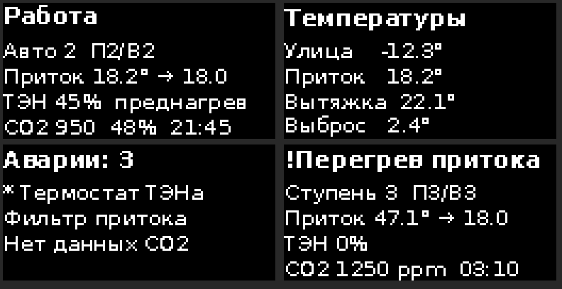

# Экран OLED и авторежим по CO2

## Подключение

Оба модуля — на шине I2C разъёма P19, вместе с ADS1115 (новых пинов не нужно).

| P19 | OLED SSD1306 (0x3C) | SCD41 (0x62) | ADS1115 (0x48) |
|---|---|---|---|
| 3V | VCC | VDD | VDD |
| GND | GND | GND | GND, ADDR |
| SDA | SDA | SDA | SDA |
| SCL | SCL | SCL | SCL |

- Шина работает на 100 кГц (предел PCF8574). Провод до SCD41 — **не длиннее ~1 м**.
- У каждого модуля обычно свои подтяжки SDA/SCL 4,7–10 кОм. С тремя модулями
  суммарно ≈ 2–3 кОм — допустимо. Если на стенде шина «сбоит», снять подтяжки с одного модуля.
- SCD41 в момент измерения берёт до ~200 мА от 3,3 В. На стенде проверить, что 3,3 В
  платы не проседает (ESP32 с Wi-Fi + SCD41): ≥ 3,2 В на P19.

**Где ставить SCD41.** В канал вытяжки у щита (через отверстие в воздуховоде или в
коробке, продуваемой вытяжным воздухом). Вытяжка — это смесь воздуха из всех комнат,
её CO2 — хороший средний показатель. Нужен датчик в комнате на длинном кабеле — вместо
SCD41 Senseair S8 по UART (`packages/sensors/co2_senseair_s8.yaml`); для него нужны два
свободных пина (RX/TX), они в проекте не заданы — их надо выбрать и указать.

## Экран

Кнопок нет, страницы меняются каждые 5 с (`oled_page_s`):

1. **Главная**: состояние (при аварии — «!» и её короткое название), режим и ступени
   притока/вытяжки, t притока → уставка, мощность ТЭНа и преднагрев, CO2, влажность, время.
2. **Температуры**: улица, приток, вытяжка, выброс («—» — датчик неисправен).
3. **Аварии и предупреждения**: короткие названия, «*» — причины нет, ждёт сброса.

При аварии каждая вторая страница — аварии. Строки обрезаются по ширине экрана
в точках; все короткие названия аварий проверены — влезают.

Яркость `oled_contrast: 50%` — чтобы OLED медленнее выгорал.

## Авторежим

Пункт «Авто» в «mode Режим вентиляции». Ступень выбирает `include/vent/auto_speed.h`:

| CO2 | Ступень |
|---|---|
| ≤ 800 ppm | 1 |
| 800–1100 ppm | 2 |
| > 1100 ppm | 3 |
| влажность > 70 % | не ниже 3 (снятие ниже 65 %) |
| нет данных CO2 | 2 (резервная) + предупреждение «Нет данных CO2» |

- Вниз — с гистерезисом 50 ppm.
- Чтобы ступень не прыгала: вверх — если новое значение держится 1 мин, вниз — 10 мин.
- Все пороги и задержки — `auto_*` в `packages/core/control.yaml`, переопределяются в
  профиле или файле объекта.
- Авторежим только выбирает ступень: последовательность пуска, нагрев, обмерзание и все
  защиты работают как в ручном режиме. Защита от обмерзания может снизить приток
  ниже выбранной авторежимом ступени — она главнее.
- Самокалибровка SCD41 (ASC) включена: датчик считает минимум за неделю равным 400 ppm.
  В проветриваемой квартире это верно; если в помещении никогда не бывает свежего воздуха —
  выключить `automatic_self_calibration` и откалибровать вручную.

Проверено тестом `tests/test_auto_speed.cpp`: пороги, гистерезис, задержки, влажность,
резервная ступень, работа в системе.
